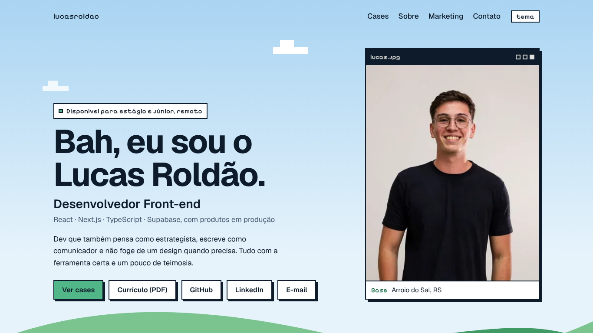

# Lucas Roldão — Portfólio

> Não é uma lista de tecnologias. É um lugar pra mostrar como eu penso — os problemas que resolvi, as decisões que tomei (inclusive as erradas) e o que aprendi no caminho.

[](https://devlucasroldao.vercel.app)
[](https://vitejs.dev)
[](https://developer.mozilla.org/docs/Web/JavaScript)
[](https://vercel.com)



---

## 📖 Sobre o Projeto

Esse é o meu portfólio pessoal — e por muito pouco não virou mais um clichê de "dev com cara de IA". Não virou porque cada decisão aqui foi questionada antes de entrar no ar, inclusive essa frase, que tá literalmente escrita no rodapé do site.

A ideia nasceu depois de ver o portfólio que minha professora Andrezza Andrade criou pra ela. Peguei a referência, pesquisei bastante coisa no Dribbble e fui construindo o meu, do jeito que quis: sem "Olá, sou desenvolvedor tal", sem lista de tecnologia solta, com a minha cara.

Aqui dá pra conhecer um pouco mais sobre mim, minha rotina, onde moro (Arroio do Sal, litoral gaúcho), e — o mais importante — os projetos reais que construí, com cliente de verdade, problema de verdade e resultado medido, não case fictício de portfólio.

---

## ✨ Funcionalidades

### Pra quem visita
- 🪟 **Visual "retrô limpo"** — layout moderno e legível, com janelas nos cards, fonte pixel só nos rótulos e uma colina com céu desenhados em CSS e SVG. Sem imagem de marca de terceiros e sem sistema operacional de mentira pra navegar
- 🧭 **Primeira tela direta** — nome, função, stack, disponibilidade e os botões de cases, currículo, GitHub, LinkedIn e e-mail, sem rolar
- 🌗 **Tema claro e escuro** — segue o sistema e guarda a escolha de quem troca
- 📄 **Funciona sem JavaScript** — o conteúdo inteiro é gerado no build e já vem no HTML. O JS do site tem 1 KB e só liga o botão de tema
- 🎈 **Um movimento só** — uma nuvem que desliza devagar, desligada pra quem pede menos movimento no sistema

### Conteúdo
- 💼 **Cases reais** — Aval (SaaS de aprovação de conteúdo para agências, com 4 demos públicas), Conecte Telecom (plataforma com contratação digital e auditoria de segurança), Lu Perfumes & Presentes (catálogo com painel próprio) e Helena Lima (marca pessoal e landing page em menos de 24h). Cada página abre com um resumo: papel, período, stack, resultado e o que dá pra clicar e conferir
- 🗣️ **Depoimentos** — três, fixos, de gente que trabalhou comigo
- 🎨 **Marketing** — um bloco curto na home com quatro peças publicadas e o currículo Web/Growth

### Por trás dos panos
- 🔍 **SEO e compartilhamento** — título, descrição, canonical e Open Graph por página, `og-image.jpg` própria, `robots.txt`, `sitemap.xml` e página 404
- 🖼️ **Imagens** — WebP com `srcset`, geradas por `scripts/images.mjs`, todas com `width` e `height` (sem pulo de layout)
- 🔒 **Headers de segurança** via `vercel.json`, que também redireciona (301) os endereços antigos `/bio`, `/marketing` e `/case-rabisco-previa`

### Lighthouse (celular, build local, 11/11/2026)

| | Desempenho | Acessibilidade | Práticas recomendadas | SEO | Peso |
|---|---|---|---|---|---|
| Home, antes do redesign | 82 | 100 | 100 | 100 | 3.637 KB |
| Home, depois | 100 | 100 | 100 | 100 | 239 KB |

> Medido com Lighthouse 12 no build local, mesmo método nas duas linhas. O maior ganho veio de tirar o vídeo de fundo do topo (2,5 MB) e de servir as imagens em WebP no tamanho certo.

---

## 🛠️ Stack Tecnológica

| Camada | Tecnologia | Decisão |
|---|---|---|
| **Build** | Vite | Uma página por HTML, com um plugin pequeno que pré-renderiza o conteúdo no build |
| **Frontend** | HTML + CSS + JavaScript puro | Sem framework — pro tamanho e propósito desse site, React/Vue seriam peso sem benefício real |
| **Fontes** | Geist + Pixelify Sans | Self-hosted em `public/fonts/`, 37 KB no total |
| **Imagens** | sharp | Converte as origens de `assets/images/` em WebP com `srcset` |
| **Deploy** | Vercel | CI/CD a cada push, headers e redirects em `vercel.json` |

---

## 🏗️ Arquitetura

```
portfolio-devlucasroldao/
├── index.html, case-*.html, 404.html   # cascas: o conteúdo entra no build
├── vite.config.js                      # plugin que preenche <!--head--> e <!--app-->
├── src/
│   ├── render.js                       # qual página recebe qual conteúdo e <head>
│   ├── data/
│   │   ├── cases.js                    # texto dos cases (fonte única)
│   │   ├── site.js                     # links, depoimentos, peças de marketing
│   │   └── images.json                 # manifesto gerado por scripts/images.mjs
│   ├── templates/                      # layout, home, case, parts
│   ├── styles/site.css                 # um arquivo, tokens no topo
│   └── main.js                         # botão de tema
├── scripts/
│   ├── images.mjs                      # npm run images
│   └── og-image.html                   # fonte da imagem de compartilhamento
├── assets/images/                      # origens das imagens (não vão pro deploy)
└── public/                             # img/ (WebP), fonts/, vídeos, currículos, og-image, robots, sitemap
```

### Rodar

```
npm install
npm run dev      # desenvolvimento
npm run build    # gera dist/
npm run images   # só quando uma imagem de origem mudar
```

Pra trocar a foto do topo: substitua `assets/images/bio/lucas-header.jpg`, ajuste o recorte em `scripts/images.mjs` se precisar e rode `npm run images`.

---

## 🎨 Identidade Visual

| | |
|---|---|
| Navy | `#0D1B2A` (texto no claro, fundo no escuro) |
| Verde | `#52B788` (acento, o mesmo dos posts do LinkedIn) |
| Céu e colina | `#A9D4F2` e `#3F9A63` |
| Fontes | Geist (texto e títulos) · Pixelify Sans (rótulos) |

---

## 🤖 IA como Ferramenta de Desenvolvimento

Esse projeto foi construído com ajuda de IA — o [Claude](https://claude.com), da Anthropic, esteve em praticamente todo o processo. Não escondo isso, mas também não foi no piloto automático.

### Como a IA foi usada na prática:

- **Implementação ponta a ponta** — do primeiro rascunho da estrutura até detalhes finos de CSS
- **Testes reais antes de qualquer entrega** — build, Playwright em várias larguras de tela, modo claro/escuro, acessibilidade, tudo verificado antes de eu ver o resultado
- **Auditoria de performance e acessibilidade** — encontrou e corrigiu problemas reais (imagens 3-6x maiores que o necessário, elementos sem rótulo acessível, vídeo de fundo sem respeitar preferência de movimento reduzido)
- **Revisão de decisão, não só execução** — quando pedi algo que ia contra minha própria estratégia (tipo destacar demais o lado de marketing quando o objetivo era mostrar que sou dev), fui questionado antes de implementar

### O que aprendi sobre usar IA:

> Não é sobre deixar a IA decidir. É sobre saber o que pedir, dar contexto suficiente pra decisão fazer sentido, e revisar o resultado como se eu mesmo tivesse escrito — porque no fim, cada coisa que está no ar eu aprovei.

A IA acelerou a execução. As decisões — o que construir, o que cortar, o que priorizar — continuam sendo minhas.

---

## 🚀 Evolução do Projeto

| Etapa | O que mudou |
|---|---|
| **Estrutura inicial** | Hero, Cases, Sobre mim, Depoimentos, CTA final — primeira versão completa |
| **Cases reais** | Conecte Telecom, Lu Perfumes e Helena Lima ganharam páginas completas, com imagens reais |
| **Modo claro/escuro** | Sistema de tema completo, com contraste ajustado nos dois modos |
| **Rabisco Prévia** | Case da ferramenta interna da Rabisco, com código aberto |
| **Redesign (nov/2026)** | Visual "retrô limpo", Aval como case principal (a Prévia virou o capítulo de origem dele), conteúdo no HTML sem depender de JS, imagens em WebP, home de 3.637 KB pra 239 KB. Saíram o vídeo do topo, a página de links e a galeria de marketing |

---

## 👨‍💻 Sobre Mim

**Lucas Roldão Cardoso** — Estudante de Análise e Desenvolvimento de Sistemas (ULBRA), hoje Desenvolvedor Web e Responsável pelos Canais Digitais na Conecte Telecom. Foi lá, por iniciativa própria, que encarei meu primeiro projeto de desenvolvimento de verdade: evoluí o site institucional que a empresa já tinha para uma plataforma completa e, no processo, encontrei e corrigi uma falha crítica de controle de acesso.

Busco minha primeira oportunidade formal como desenvolvedor: estágio ou júnior em front-end, remoto ou presencial no Litoral Norte e em Porto Alegre.

[](https://linkedin.com/in/devlucasroldao)
[](https://github.com/devlucasroldao)

---

<div align="center">
  <p>Arroio do Sal, RS</p>
  <p><em>"Bah, eu sou o Lucas Roldão."</em></p>
</div>
